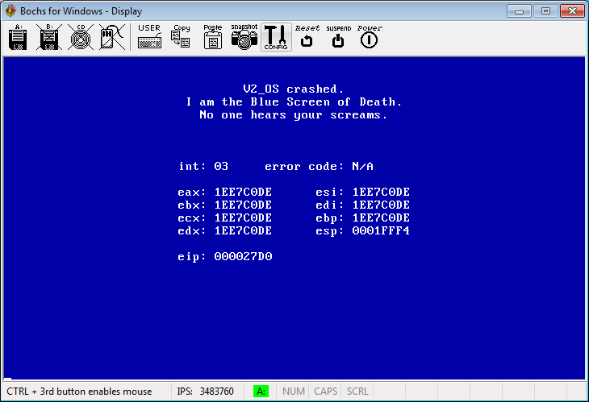

# Ausgabe 2

|  |  |
| ----- | -------------------------------------------------------------------------------------------------------------------------------------------------------------------------------------------------------------------------------------- |
| © | Dieser Artikel ist urheberrechtlich geschützt. Bitte beachte, dass die üblichen [Lizenzbestimmungen](https://lowlevel-eu.github.io/wiki/pages/1637/index.html "Lowlevel:Urheberrecht") des Wikis für diesen Artikel nicht gelten. |

  

|  |  |  |
| ------------------------------------------------------------------------------- | ---------------- | ------------------------------------------------------------------------------- |
| « [Ausgabe 1](Ausgabe-1 "Ausgabe 1") | **Navigation** | [Ausgabe 3](Ausgabe-3 "Ausgabe 3") » |

## Vorwort

Das ist nun die zweite Ausgabe von Lowlevel. Nach der doch sehr positiven Resonanz von Ausgabe 1 habe ich beschlossen, das Projekt fort zu führen. Und ich hoffe, dass ich es nicht umsonst mache...

Eine Bitte habe ich jedoch: ich habe nicht ewig Zeit, um an Lowlevel zu schreiben. Wenn ihr also Content habt, den ihr mir zu Verfügung stellen könnt - egal was, Hauptsache OS Dev-mäßig - dann schickt es mir! Ich mache mir wirklich extrem viel Mühe, um die Zeitschrift regelmäßig voll zu kriegen, also... ihr könntet mir ein wenig Arbeit abnehmen ;-)

Aber auf jeden Fall danke ich allen, die mich unterstützen und die mir ihre Meinung gemailt haben.

Und ich bitte um Entschuldigung wegen den zahlreichen Verspätungen, denn die deutsche Terrorkom hatte mir irrtümlicherweise das Internet gesperrt.

## News

Sorry, keine News diesmal... leider keine Zeit. Wer Newsredakteur bei Lowlevel werden will, kann mir eine Mail schreiben.

## Leserbriefe

**Hallo, ich habe gerade auf www.coder-area.de deine Werbung zu deiner Zeitschrift gelesen und gleich einmal reingeschnuppert. Da ich bisher wenig Ahnung vom Aufbau eines Betriebssystems habe, kommt mir diese Gelegenheit gerade recht, um mein Wissen in dieser Beziehung ein wenig aufzufrischen. Weiter so! \[...\]**

Freut mich, dass es dir gefallen hat! Ich werde auf jeden Fall weitermachen!

  
**\[...\] Sehr schönes Magazin. Die erste Ausgabe hat mich sehr begeistert. Leider beherrsche ich noch nicht all zu Viel Grundlagen von Assembler, um ganz durchzusteigen, hast du mir da nicht ein Paar Adressen die sich mit Assembler-Programmierung beschäftigen? \[...\]**

Tja... da wäre zum Beispiel Snakebytes berühmtes Assembler-Tutorial: <http://kryptocrew.de/archiv/coding/asm/Asmtut.html>, hier eine Art "Referenz":<http://webster.cs.ucr.edu/> und Andre Müllers Tutorial, von dem wir auch Teile hier abdrucken: <http://andremueller.gmxhome.de/toc.html>

## OS-Dev-Tutorial, Teil 2

**Hinweis:**

Siehe auch: [Kernel](Kernel "Kernel")

Bevor man ein Betriebssystem programmiert, sollte man sich überlegen, wie das Ganze aufgebaut werden soll. Die zur Zeit wichtigsten Modelle sind:

      1. Monolithischer Kernel
      2. Microkernel
      3. Exokernel

Jeder dieser Kernels hat seine eigenen Vor- und Nachteile, die ich hier kurz darstellen möchte.

### Der monolithische Kernel

Der monolithische Kernel ist noch die meistgenutzte Architektur. OSes wie z.B. Windows benutzen diese traditionelle Form des Kernels. Der größte Teil des Hardware-Interfaces und der Interrupts sind direkt im Kernel implementiert.

Einen monolithischen Kernel zu schreiben, kann ganz schön schwierig sein, da die einzelnen Module des OSes untereinander kommunizieren müssen, und das ist wegen der fehlenden Hardware-Abstraktion recht schwierig. Im Idealfall bietet jedes Modul eine Art **Interface**, über das andere Module mit ihm kommunizieren können.

Leider ist dies leichter gesagt als getan. Da bei einem monolithischen Kernel meistens alle Module in einem Speicherbereich liegen, kann ein Bug gleich den gesamten Kernel zum Absturz bringen.

Beispiele für monolithische Kernels: **Windows** und **Linux**.

### Der Microkernel

Der Microkernel wurde erfunden, um die Probleme zu lösen, die bei einem monolithischen Kernel auftreten. Ein Microkernel wird, wie der Name schon sagt, möglichst klein gehalten. Er hat nur die Aufgabe der Verwaltung von **Ressourcen**: er bestimmt lediglich, wann ein Programm welche Teile des Systems nutzen darf.Das Nutzen der Ressourcen, also die eigentliche Arbeit übernehmen dann **Treiber** oder **Server**.

Das hat den Vorteil, dass man den Microkernel in Supercomputern genauso wie in kleinsten Geräten, zum Beispiel einem Handy verwenden kann, weil der Kernel selbst nichts von den vorhandenen Ressourcen weiß oder wissen muss.

Da also Kernel und die verschiedenen Treiber/Server getrennt laufen, ist ein Microkernel sehr viel stabiler als ein monolithischer Kernel, weil ein Fehler in einem Modul lediglich das Modul zum Absturz bringt, aber nicht gleich den ganzen Kernel.

Ein Beispiel für einen Microkernel ist **QNX RTOS**, das man als Privatanwender kostenlos downloaden kann. Für kommerzielle Entwickler kostet es, soweit ich weiß, 3000 €.

<http://www.qnx.com>

### Der Exokernel

Der Exokernel ist dem Microkernel in dem Punkt, dass die Hardwareabstraktion vom Kernel getrennt wird, sehr ähnlich. Allerdings wird das Hardwareinterface bei dieser Architektur nicht in Programmen mit Kernelrechten, sondern in einer Art von **DLLs** (oder für Linux-User: **Shared Libraries**) implementiert, die auf der User-Ebene laufen.

Diese Vorgehensweise hat den Vorteil, dass Anwendungsprogrammierer, wenn sie das wünschen, direkt auf die Hardware zugreifen können. Normale Anwendungen, beispielsweise Windowsprogramme, brauchen die Hardwareabstraktion natürlich. Sie können auf die "DLL", das sogenannte **LibOS** zugreifen. LibOSes können z.B. harmonisch nebeneinander ein Windows- und ein Linux-System simulieren, auf denen dann gewöhnliche Programme laufen.

Soweit ich weiß, ist das bisher einzige Exo OS für den PC **"xok/ExOS"**, das man kostenlos herunterladen kann. Das libOS ExOS simuliert ein Unix-System, auf dem Anwendungen wie gcc laufen. <http://www.pdos.lcs.mit.edu/exo/>

### Abschließende Worte

Leute, die sich ernsthaft mit OS Dev beschäftigen, sollten dieses wichtige Kapitel - nämlich das Design des Kernels - auf keinen Fall überspringen. Ich kann aus Erfahrung sagen, dass ein OS umso stabiler, sicherer und schneller läuft, je mehr man sich vor der eigentlichen Implementierung Gedanken über den Kernel macht.

Denn wenn man einfach so drauflos programmiert, kommt man vielleicht am Anfang schnell weiter, doch irgendwann steht man vor einem riesigen Designproblem und man weißt nicht, wo man anpacken soll. Deshalb befolgt meinen Ratschlag und plant eure Software genau aus.

## Lowlevel-Grundlagen, Teil 2

Die CPU ist kein Alleskönner. Auf einem IBM-PC gibt es noch andere Einheiten, die unabhängig von der CPU arbeiten. Um an die Daten zu kommen, die diese Geräte an die CPU senden, gibt es zwei Methoden, die ich kurz darstellen möchte.

### Polling

Die CPU stoppt nach bestimmten Zeitabschnitten die Ausführung des Programms (oder des Betriebssystems), und checkt bei jedem Gerät, ob Daten angekommen sind und ob diese verarbeitet werden müssen. Wenn ja, wird eine entsprechende Routine gecallt, die die jeweilige Verarbeitung aufnimmt.

Leider ist diese Methode sehr ineffizient, da sie sehr viel Rechenkapazität in Anspruch nimmt und dadurch die CPU völlig ausbremsen kann. Außerdem besteht die Gefahr, dass Daten verloren gehen, wenn größere Datenmengen von verschiedenen Ports an die CPU gesendet werden.

### Interrupts

Eine sehr viel bessere Methode ist die Methode der Interrupts. Bei diesem Konzept bekommt jedes Gerät, das mit der CPU kommuniziert, eine Art "Signalgeber", mit der es der CPU signalisieren kann, dass Daten gesendet wurden und die CPU nun die Daten verarbeiten muss. Die CPU unterbricht (**interrupts**) nun das Programm und verarbeitet die Daten mit einer Routine, die vorher festgelegt wurde. Wie diese System genau funktioniert, werden wir uns später anschauen.

Diese Methode hat einige Vorteile. Zum Beispiel kann die CPU das Programm, das geladen ist, permanent ausführen, und das Programm wird nur dann unterbrochen, wenn es wirklich sein muss.

So, Schluss jetzt mit dem theoretischen Gelaber. Schauen wir uns an, wie das genau funktioniert und wie das auf dem IBM-PC implementiert ist ;-)

Intel hat für diese Zwecke extra einen neuen Chip gebaut, den **8259 Interrupt Controller** (auch **PIC** genannt, **Programmable Interrupt Controller**). Dieser Chip hat 8 Leitungen (IRQ 0 - 7) für jedes einzelne Gerät, das der CPU etwas mitteilen muss. Die einzelnen Leitungen nennt man **IRQ Lines** (Interrupt ReQuest). Da jedoch 8 IRQs zuwenig waren, baute Intel einen zweiten Interrupt Controller in den IBM-PC, der über IRQ 2 mit dem ersten verbunden war.

Wie man sieht, ist IRQ 2 nicht als solches verwendbar, sondern dient lediglich zur Kommunikation. Aus Kompatibilitätsgründen wurde deshalb IRQ 2 mit IRQ 9 des 2. Controllers verbunden.

Zu kompliziert? Ganz einfach: wenn ein Gerät IRQ 2 benutzt, dann benutzt es in Wirklichkeit IRQ 9.

Was passiert nun, wenn ein Gerät einen Interrupt Request über eine IRQ Line sendet? Als erstes gelangt das Signal ins Interrupt **Mask Register (IMR)**. Hier wird festgestellt, ob der IRQ überhaupt verarbeitet werden muss oder nicht (Masking, darauf werde ich allerdings nicht näher eingehen).

Als nächstes gelangt das Signal in den **Priority Resolver**. Dieser findet heraus, welche IRQs zuerst, bzw. welche zuletzt verarbeitet werden müssen. Je niedriger die IRQ-Nummer, desto mehr Priorität hat das Signal (IRQ 0 hat also am meisten Priorität, gefolgt von IRQ 1 usw.)

Nun ist der Interrupt Controller mit allen Vorarbeiten fertig und muss der CPU sagen, dass ein Interrupt ausgelöst wurde. Dies geschieht durch ein **INT-Signal** (Interrupt-Signal), das durch die Interrupt-Leitung des Prozessors gesendet wird. Der Prozessor wird die Anweisung beenden, die er gerade ausführt, und anschließend ein **INTA (Interrupt Acknowledge)** zurücksenden, das den Erhalt des IRQs bestätigt.

Wenn der PIC das INTA-Signal bekommt, wird die Nummer des IRQs im **In Service Register (ISR)** gespeichert, welches also zeigt, welcher IRQ gerade aktiv ist. Außerdem wird es aus dem Interrupt Request Register gelöscht, weil der Prozessor sich ja schon um den IRQ kümmert.

Der Prozessor wird nun ein weiteres INTA-Signal an den PIC senden, um ihm zu sagen, dass er einen 8 Bit-Pointer mit der Nummer des ausgelösten IRQs in den Daten-Bus stellen soll. Die CPU muss schließlich wissen, welcher Interrupt ausgelöst wurde.

Anschließend wird der Prozessor den Interrupt Handler (auch **ISR, Interrupt Service Routine** genannt, aber nicht mit dem In Service Register verwechseln!) aufrufen, der zum jeweiligen Interrupt dazugehört.

Nur: woher weiß der Prozessor, wo der Interrupt Handler ist?

### Interrupt Vector Table

8086-Prozessoren benötigen eine so genannte **Interrupt Vector Table**, an der Adresse 0000:0000, die 1024 Bytes lang ist. Diese Tabelle beinhaltet die Adressen der Interrupt Handler, die aufgerufen werden, wenn ein Interrupt ausgelöst wird. Jede dieser Adressen ist 4 Bytes lang, deshalb kommen wir auf 1024 / 4 = 256 Interrupts, die in der Tabelle sein können.

| INT (Hex) | IRQ | Bedeutung |
| ----------- | --------------------- | ------------------------------------------------------------------------------------------------------------------------------- |
| 00 - 01 | Exception Handlers | Exceptions werden später behandelt |
| 02 | Non-Maskable IRQ | Non-Maskable IRQ (Parity Fehler) |
| 03 - 07 | Exception Handlers | \- |
| 08 | Hardware IRQ0 | System-Timer |
| 09 | Hardware IRQ1 | Keyboard |
| 0A | Hardware IRQ2 | Umgeleitet zu IRQ 9 |
| 0B | Hardware IRQ3 | [Serielle Schnittstellen](Serielle-Schnittstelle "Serielle Schnittstelle") COM2/COM4 |
| 0C | Hardware IRQ4 | Serielle Schnittstellen COM1/COM3 |
| 0D | Hardware IRQ5 | meistens Soundkarte |
| 0E | Hardware IRQ6 | Diskettenlaufwerk-Controller |
| 0F | Hardware IRQ7 | Parallel-Port |
| 10 - 6F | Software Interrupts | Software INTs werden später behandelt |
| 70 | Hardware IRQ8 | [Real Time Clock](Real-Time-Clock "Real Time Clock") |
| 71 | Hardware IRQ9 | umgeleiteter IRQ2 |
| 72 | Hardware IRQ10 | \- |
| 73 | Hardware IRQ11 | \- |
| 74 | Hardware IRQ12 | PS/2 Maus |
| 75 | Hardware IRQ13 | Mathematischer Co-Prozessor |
| 76 | Hardware IRQ14 | Festplatte |
| 77 | Hardware IRQ15 | \- |
| 78 - FF | Software Interrupts | \- |

### Software Interrupts

Wenn Sie jemals in Assembler unter DOS programmiert haben, dann wissen Sie wahrscheinlich, dass die meisten DOS-Funktionen über INT 21h abgewickelt werden. Wenn man zum Beispiel eine Datei über eine DOS-Funktion öffnen wollen, dann müssen Sie nur INT 21h mit dem richtigen Parameter aufrufen.

Das BIOS benutzt ein ähnliches Interface, um dem Betriebssystem Zugriff auf BIOS-Funktionen zu geben. Die Interrupts 10h, 13h und 16h sind BIOS-Interrupts, die die Hardware kontrollieren. Moderne Betriebssystem wie Windows und Linux verzichten auf das BIOS und kommunizieren mit der Hardware direkt durch Treiber (im Übrigen geht das gar nicht anders, aber das ist ein anderes Thema).

### Exceptions

Exceptions sind besondere Interrupts, die automatisch ausgelöst werden, wenn etwas mit dem Code, der gerade ausgeführt wird, schief läuft, wie zum Beispiel eine Division durch Null.

| Nr. | Bedeutung |
| ----- | ----------------------------- |
| 0 | Divide Error |
| 1 | Debug Exceptions |
| 2 | reserved |
| 3 | Breakpoint |
| 4 | Overflow |
| 5 | Bounds Check |
| 6 | Invalid Opcode |
| 7 | Coprocessor Not Available |
| 8 | Double Fault |
| 9 | Coprocessor Segment Overrun |
| 10 | Invalid TSS |
| 11 | Segment Not Present |
| 12 | Stack Exception |
| 13 | General Protection Fault |
| 14 | Page Fault |
| 15 | reserved |
| 16 | Coprocessor Error |

### Nächstes Mal...

Ich glaube, es wird langsam Zeit, ein wenig Code anzufassen... aber dann in der nächsten Ausgabe - da werden wir uns dann anschauen, wie man eigene Interrupt Handler schreibt.

## Code Corner

### Delay-Funktion

\<asm\>  ; delay processing for amount of clock ticks

       ; SI = ticks to wait
       DELAY:
       XOR AH,AH
       INT 0x1A
       ADD DX,SI
       MOV BX,DX
       .WL:
       INT 0x1A
       CMP DX,BX
       JNE .WL
       RET</asm>

### String-Funktionen

\<asm\>  ; YaOS v0.1 STRING.INC file, programmed by Zero Design

       ; Routines in this file-
       ; UCASE_STRING: turn a string into uppercase letters
       ; RTRIM_STRING: right space trim a string
       ; LTRIM_STRING: left space trim a string
       ; STRLEN: get strings length
       
       
       UCASE_STRING: ; ES:SI = offset of string
       CALL STRLEN
       MOV CX,BX
       .UCASE:
       DEC CX
       MOV BX,CX
       MOV AL,[SI+BX]
       CMP AL,123
       JB .NOTABOVE
       INC CX
       JMP .NOTLOWCASE
       .NOTABOVE:
       CMP AL,97
       JNB .LOWCASE
       INC CX
       JMP .NOTLOWCASE
       .LOWCASE:
       SUB AL,32
       MOV [SI+BX],AL
       INC CX
       .NOTLOWCASE:
       LOOP .UCASE
       RET
       
       RTRIM_STRING: ; right space trim a string, ES:SI = offset of string
       CALL STRLEN
       MOV CX,BX
       DEC CX
       .RTRIM:
       MOV BX,CX
       MOV AL,[SI+BX]
       CMP AL,32
       JNE .DONE
       MOV BYTE [SI+BX],0
       LOOP .RTRIM
       .DONE:
       RET
       
       LTRIM_STRING: ; left space trim a string, ES:SI = offset of string
       CALL STRLEN
       PUSH SI
       MOV CX,BX
       XOR BX,BX
       .LT1:
       MOV AL,[SI+BX]
       CMP AL,32
       JNE .LT2
       CMP AL,0
       JE .EOS
       INC BX
       JMP .LT1
       .LT2:
       MOV DI,SI
       ADD SI,BX
       REP MOVSB
       .EOS:
       POP SI
       RET
       
       STRLEN: ; get strings length, ES:SI = offset of string, BX returns length
       XOR BX,BX
       .STRLEN:
       MOV AL,[SI+BX]
       CMP AL,0
       JE .STRDONE
       INC BX
       JMP .STRLEN
       .STRDONE:
       RET</asm>

## OS Projekte: V2_OS

Ein Betriebssystem, komplett in 32bit-Assembler geschrieben! Kann das gut gehen? V2_Lab demonstriert eindrucksvoll, dass es möglich ist!

### Screenshots

Den von Windows bekannten Bluescreen gibt es auch bei V2_OS.

### OS Design

Einige sehr innovative Features. Zum Beispiel gibt es mehrere Konsolen, für die verschiedensten Zwecke:

- Terminal-Konsole (zum Arbeiten)
- Modul-Konsole (Übersicht aller laufenden Module)
- Boot-Konsole (Bootinformationen)
- Debug-Konsole (Debuggen)
- Crash-Konsole (wenn der Kernel eine Panic auslöst)

### Funktionalität

Eingeschränkt. Der Kernel alleine kann nur sehr wenig. Erst durch verschiedene Module und Programme wird die Funktionalität Stück für Stück erweitert. Obwohl die V2_OS-Community recht groß ist, sind leider diese Module Mangelware...

Nichtsdestotrotz gibt es Module für:

- VESA
- Maus (seriell / PS2)
- TCP/IP
- Ramdisk

Als kleine Besonderheit lässt sich V2_OS auch auf einer mit V2_FS formatierten Festplatte installieren.

### Stabilität / Kompatibilität

Sehr gut. V2_OS ist extrem schnell und läuft stabil. Abstürze haben wir nur erlebt, wenn ein Programm versucht hat, auf ein Modul zuzugreifen und dieses Modul nicht geladen war.

Anscheinend soll V2_OS auch unter Bochs laufen, aber Bochs stürzte bei den Tests immer ab (auch nachdem der Kernel Bochs-konform kompiliert wurde). Wenn jemand V2_OS unter Bochs zum Laufen gekriegt hat, sollte sich derjenige bei mir per Mail melden und mir sagen, wie er das hingekriegt hat :-)

### Dokumentation

Nicht gut. Die DOCs sind zwar ausführlich, aber schon veraltet. Und wenn man versucht, auf die Seite des neuen DOC-Projekts zu kommen, kommt ein \#404-Error...

### Fazit

V2_OS ist eines der besseren Betriebssysteme! Leider sieht es so aus, also ob nicht mehr viele Leute an V2_OS arbeiten... das ist wirklich schade.

## Phils Kolumne

**Hauptsache Deutsch...** Auf einen Nenner gebracht könnte man sagen: "Je Deutsch desto DAU".... zu blöd um einige Worte Englisch zu lernen, aber mit einem PC rumspielen wollen. Und solche Leute müllen einem als Programmierer dann noch den Mail-Eingang zu, mit Forderungen nach einer "endlich deutschen Version".

Ja, ich bin genervt. Ich rege mich auf. Da hat man eine neue Technik und nun endlich die einmalige Chance, weltweit einheitliche Begriffe zu entwickeln - und was passiert? Einige unverbesserliche Deutschtümmler beharren auf die Entwicklung typisch deutscher Begriffe - mit dem Ergebnis dass keiner keinen mehr versteht, langsam sogar alte Hasen Probleme damit haben, zu verstehen, was eigentlich gemeint ist und irgendwie nichts mehr wirklich einen Sinn ergibt.. Aber Hauptsache Deutsch....

Hier 2 Beispiele die mir besonders gut gefallen:

- "Konvertiert Frequenzen und Bits pro Beispiel aus PCM-Audiodaten." - gemeint ist damit sicher "per sample" ..
- "Vorgänge beim Öffnen von Dateien und Starten von Dateianhängen zulassen" .. oooops???

Nein, ich würde den Umstand, dass der Command-Interpreter, unsere Shell, neuerdings "Eingabeaufforderung" heißt und Exceptions mit "Unterbrechungen" betitelt werden, nicht so einfach hinnehmen... ja wäre da nicht die Tatsache, dass durch Massenproduktion (jeder Dösdaddel glaubt doch, er bräuchte einen Rechner) alles richtig günstig geworden ist....

**phil**

## Nachwort

Naah, die Ausgabe ist leider nicht so voll geworden wie ich gehofft hatte, obwohl recht viele Leute mir Material gesendet haben... aber egal, es kommt schließlich auf Qualität und nicht auf Quantität an!

**Mastermesh**

|  |  |  |
| ------------------------------------------------------------------------------- | ---------------- | ------------------------------------------------------------------------------- |
| « [Ausgabe 1](Ausgabe-1 "Ausgabe 1") | **Navigation** | [Ausgabe 3](Ausgabe-3 "Ausgabe 3") » |

---

[Originalversion und Autorenschaft](https://lowlevel-eu.github.io/wiki/revisions/9220/index.html) · [MediaWiki-Versionsgeschichte](https://lowlevel-eu.github.io/wiki/history/1415/index.html)

<!-- MediaWiki page 1415; revision 9220; parent 9208; 2011-01-02T15:26:43Z -->
