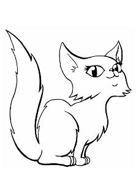
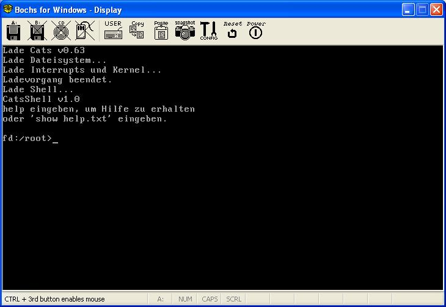

# Cats

**Löschhinweis:**

Dieser Artikel wurde zum Löschen vorgeschlagen.

Wieder ein eingestelltes OS (Katzen sind übrigens meine Lieblingstiere, weshalb mir hier der Löschvorschlag echt schwerfällt). --[DerHartmut](https://lowlevel-eu.github.io/wiki/pages/1865/index.html "Benutzer:Hartmut") 10:39, 11. Feb. 2011 (CET)

| Cats |  |
| -------------------------------------------------------------------------------------------------------------------------------------------------------------------------------------------------------------------------------------------------- | ------------------------------------------------------------------------------------------------------------------------------------------------------------------------------------------------ |
|  |  |
| Entwickler: | Peter Kowalsky (Cyborg00222), Josef Biehler (Dateisystem) |
| Akt. Version: | 0.63 |
| [Lizenz](Lizenzen "Lizenzen"): | BSD |
| OS-Eigenschaften |  |
| Plattform: | [x86](X86 "X86") |
| [Kernelart](Kernel "Kernel"): | Monolithischer Kernel |
| [Sprache](Kategorie-Programmiersprache "Kategorie:Programmiersprache"): | [Assembler](Assembler "Assembler"), [C](C "C")/[C++](C%2B%2B "C++") |
| API: |  |
| Binärformat: |  |
| [IPC-Methode](Interprozesskommunikation "IPC"): |  |
| Homepage |  |

\[nicht mehr vorhanden\]

  
Cats wurde zugunsten von DeviOS eingestellt.......

Ein kleines OS das auf jedem PC mit einem Diskettenlaufwerk läuft. Es wurde bereits folgendes implementiert:

- FAT-Treiber
- Shell
- kleiner Texteditor

## Befehle

- date
- time
- cd
- mkdir
- cls
- show
- tiny
- sdir
- help
- tasks
- kill
- tsr
- sver
- echo
- halt

## Screenshots

---

[Originalversion und Autorenschaft](https://lowlevel-eu.github.io/wiki/revisions/9523/index.html) · [MediaWiki-Versionsgeschichte](https://lowlevel-eu.github.io/wiki/history/2084/index.html)

<!-- MediaWiki page 2084; revision 9523; parent 8912; 2011-02-11T09:39:48Z -->
