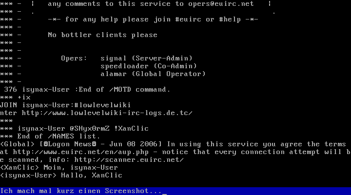
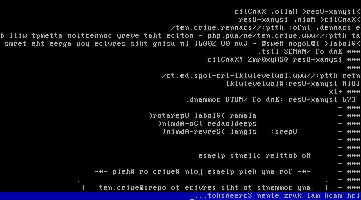

# Isynax

| Isynax |  |
| ----------------------------------------------------------------------------------------------------- | ------------------------------------------------------------------------------------------------------------------------------------------------------ |
|  |  |
| Entwickler: | [XanClic](https://lowlevel-eu.github.io/wiki/pages/1860/index.html "Benutzer:XanClic") |
| Akt. Version: | \- |
| [Lizenz](Lizenzen "Lizenzen"): | MIT |
| OS-Eigenschaften |  |
| Plattform: | [i386](X86 "X86") |
| [Kernelart](Kernel "Kernel"): | Monolith |
| [Sprache](Kategorie-Programmiersprache "Kategorie:Programmiersprache"): | [Assembler](Assembler "Assembler") ([FASM](Flat-Assembler "FASM")) |
| API: | \- |
| Binärformat: | \- |
| [IPC-Methode](Interprozesskommunikation "IPC"): | \- |
| Homepage |  |

[Gitorious](http://gitorious.org/isynax)

  
Isynax soll ein möglichst kleines Betriebssystem sein, dessen einzige Aufgabe die Benutzung des IRC ist.

Es gibt keine Prozesse, der gesamte Code läuft im Kernelmodus. Das Betriebssystem läuft im ProtectedMode.

## Features

Bis jetzt gibt es eine Unterstützung für die [RTL8139](RTL8139 "RTL8139")-Netzwerkkarte, [ARP](Address-Resolution-Protocol "ARP"), [IP](Internet-Protocol "IP") und Minimalunterstützung für TCP.

## Screenshot

  
**Für alle Intelliebhaber im normalen Modus...**  
  
  
**...Und für AT&T-Fans auch andersrum! Aktivierbar per wrong=1 anstatt von wrong=0 im Code.**

## Weblinks

- Der Code bei [Gitorious](http://gitorious.org/isynax)
- Ein relativ aktuelles Image unter [\[1\]](http://www.xanclic.bplaced.net/isynax.img.bz2), Falschrumversion unter [\[2\]](http://www.xanclic.bplaced.net/asynax.img.bz2)

---

[Originalversion und Autorenschaft](https://lowlevel-eu.github.io/wiki/revisions/6074/index.html) · [MediaWiki-Versionsgeschichte](https://lowlevel-eu.github.io/wiki/history/2066/index.html)

<!-- MediaWiki page 2066; revision 6074; parent 5874; 2009-10-15T20:59:10Z -->
