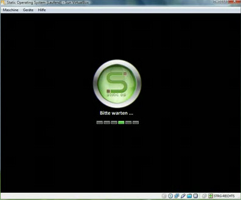
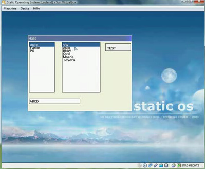
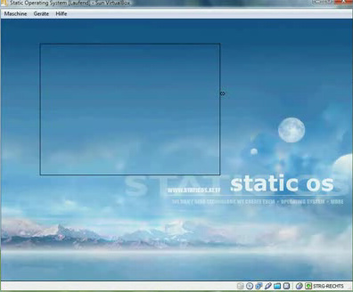

# Static OS

**Static Operating System** (Static OS) ist ein 32 Bit Betriebssystem, welches von Stefan Mayer entwickelt wird. Das Betriebssystem wird derzeit noch als Closed Source entwickelt. Ein Video welches den Betrieb des OS zeigt, kann auf Youtube angesehen werden:

[Static Operating System RUN](http://www.youtube.com/watch?v=fF-6pyQtDJQ)

| Static Operating System |  |
| ----------------------------------------------------------------------------------------------------- | ---------------------------------------------------------------------------------------------------------------------------- |
|  |  |
| Entwickler: | [Stefan Mayer](https://lowlevel-eu.github.io/wiki/pages/2055/index.html "Benutzer:Hunter") |
| Akt. Version: | 1.8 |
| [Lizenz](Lizenzen "Lizenzen"): | \- |
| OS-Eigenschaften |  |
| Plattform: | [i386](X86 "X86") |
| [Kernelart](Kernel "Kernel"): | Microkernel |
| [Sprache](Kategorie-Programmiersprache "Kategorie:Programmiersprache"): | [C](C "C"), [ASM](Assembler "Assembler") |
| API: | SOS_API |
| Binärformat: | [ELF](Executable-and-Linking-Format "ELF") |
| [IPC-Methode](Interprozesskommunikation "IPC"): |  |
| Homepage |  |

<http://www.staticos.at.tf/>

  

## Features

**Version 1.8**

- 32 Bit
- Intel x86 Architektur
- GRUB als Bootloader (Multiboot fähig)
- Protected Mode
- Paging / Phys-Virt-Memorymanagement (malloc/realloc/free)
- IDT / GDT / TSS
- PIC / PIT
- Multitasking (Ring 0 / Ring 3)
- Elf-Support
- ATAPI / ATA (derzeit noch im Kernel implementiert)
- FDC (z.z. keien Verwendung)
- Virtual 8086 Modus (ermöglicht das Ausführen von 16 Bit Code im Protected Mode)
- Maus / Tastatur - Treiber (Treibermanagement -\> völlig eigenständige Treiber)
- VESA (Verschiedene Auflösung durch V8086 Task möglich / Standart: 800x600x24bpp )
- Grafische Benutzeroberfläche
  - Fenster (verschiebbar, Größe veränderbar)
  - Labels (Zur einfachen Textausgabe in Fenstern)
  - Buttons
  - Textbox
  - Listbox (beliebig Einträge abfragen/hinufügen/editieren/entfernen)
  - Pictures (SBF, SCU, BMP, RAW)
  - Font-Support (Verdana, Courier New, Comic Sans, Impact, ...)
- API
  - Taskhandling
  - User Speicherzugriffe (umalloc)
  - Funktions/Handler-Registrierung
  - IPC (Inter Process Communication)
  - ...

  

## Screenshots

Static Operating System Ladevorgang

Static Operating System GUI Test

Static Operating System Fenster vergrößern

  

## Download

[Download](http://www.e-d-l.at/temp/staticos/StaticOS_QEMU.rar)

---

[Originalversion und Autorenschaft](https://lowlevel-eu.github.io/wiki/revisions/9002/index.html) · [MediaWiki-Versionsgeschichte](https://lowlevel-eu.github.io/wiki/history/2050/index.html)

<!-- MediaWiki page 2050; revision 9002; parent 5795; 2010-11-28T10:20:52Z -->
