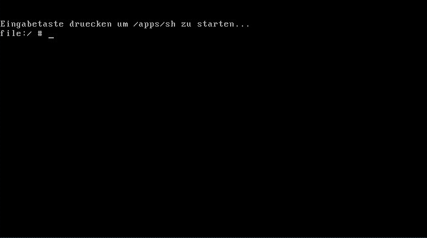
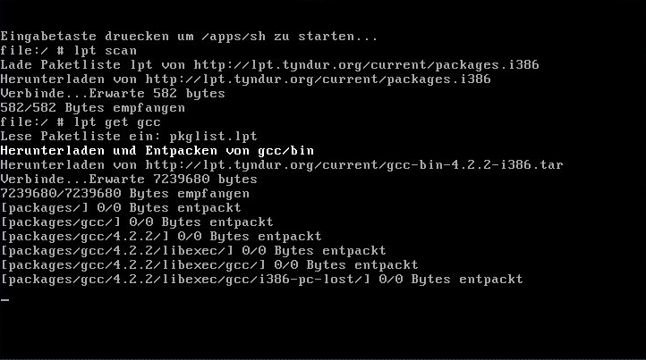
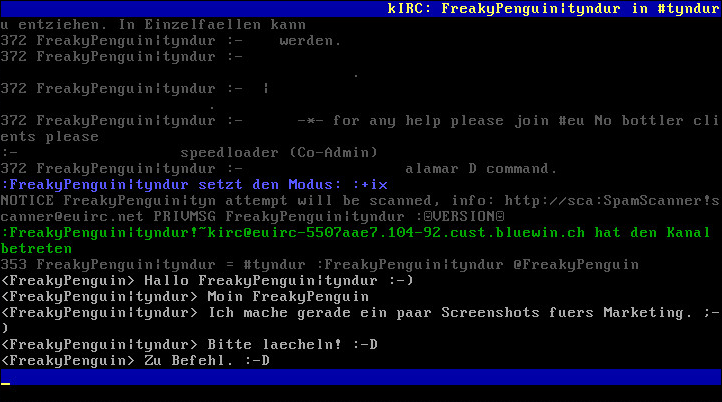
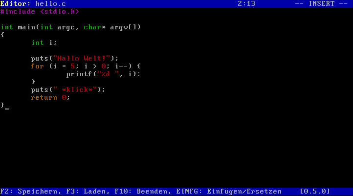
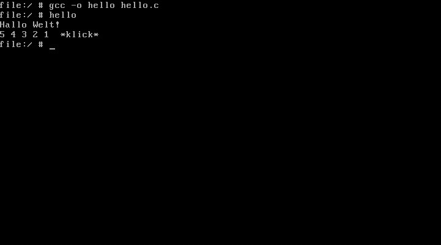
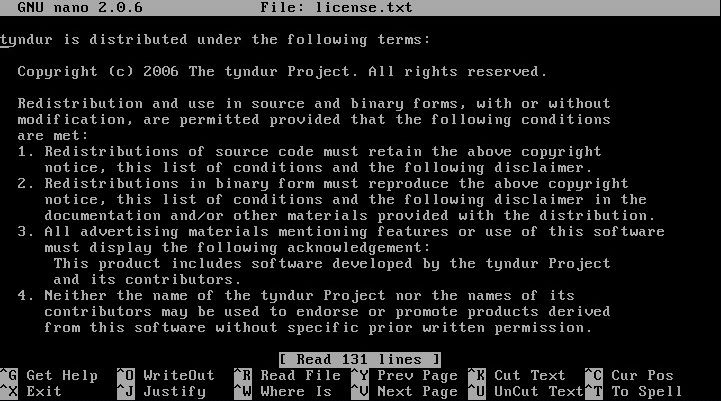

# Týndur/Screenshots

# 0.2-gothmog

## Nach dem Starten

## Paketverwaltung lpt

## IRC-Client

## Texteditor

## GNU gcc

## GNU nano

---

[Originalversion und Autorenschaft](https://lowlevel-eu.github.io/wiki/revisions/5602/index.html) · [MediaWiki-Versionsgeschichte](https://lowlevel-eu.github.io/wiki/history/1803/index.html)

<!-- MediaWiki page 1803; revision 5602; parent 3838; 2009-08-12T16:20:36Z -->
