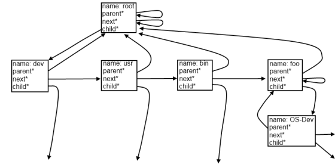

# Virtuelles Dateisystem

Ein virtuelles [Dateisystem](Dateisystem "Dateisystem") (VFS &#150; Virtual File System) abstrahiert verschiedene reale Dateisysteme. Dadurch muss ein Programm, das auf Dateien zugreift, nicht wissen, auf welchem Dateisystem sie liegen.

Ein weiterer Vorteil besteht darin, dass die „realen“ Dateisysteme nicht wirklich real sein müssen. Sie müssen nicht wirklich auf einem physischen Medium existieren, sie können auch selbst „virtuell“ sein (wie zum Beispiel das Linux-Dateisystem procfs).

## Aufbau

Ein VFS lässt sich als Baum implementieren. Dabei ist jedes Element (Node) mit den "umliegenden" Nodes verkettet. folgendermaßen könnte ein Ausschnitt aus einem VFS aussehen, die Nodes können (und sollten) mehr Elemente als die dargestellten enhalten:  
  
Weitere Elemente eines Nodes könnten zum Beispiel ein (Funktions-)Pointer auf einen Treiber, eine Inode-Nummer, oder einen Zugriffszähler enthalten. Weiterhin wäre es sinnvoll zu speichern welche Art von Node vorliegt, eine Datei, ein Ordner, ein Gerätetreiber...

## Weblinks

- [James M.'s kernel development tutorial, Teil 8 (The VFS and the initrd)](http://www.jamesmolloy.co.uk/tutorial_html/8.-The%20VFS%20and%20the%20initrd.html)
- [Wikipedia-Artikel (Deutsch)](http://de.wikipedia.org/wiki/Virtual_file_system)

---

[Originalversion und Autorenschaft](https://lowlevel-eu.github.io/wiki/revisions/8646/index.html) · [MediaWiki-Versionsgeschichte](https://lowlevel-eu.github.io/wiki/history/2019/index.html)

<!-- MediaWiki page 2019; revision 8646; parent 8645; 2010-10-13T12:53:33Z -->
