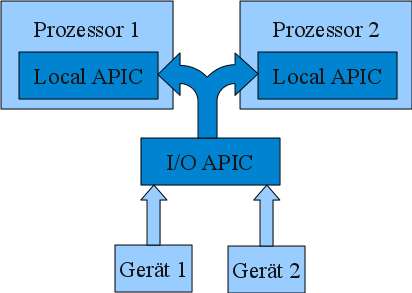

# Advanced Programmable Interrupt Controller

Diese Seite ist ein Artikel, welcher **mehr** haben könnte..  

Wenn du mehr darüber weißt oder recherchieren willst, bist **du** aufgerufen, dies zu tun. Wenn du dir in einer Sache nicht sicher bist, dann stell es auf die Diskussionsseite.

Die **APIC**-Architektur (**A**dvanced **P**rogrammable **I**nterrupt **C**ontroller) sorgt für die Verteilung der [Interrupts](Interrupt.md "Interrupt") auf [x86](X86.md "X86")-Systemen und besteht aus mehreren separaten Controllern:

- eine oder mehrere [I/O APICs](I-O-Advanced-Programmable-Interrupt-Controller.md "I/O APIC")
- eine [Local APIC](Local-Advanced-Programmable-Interrupt-Controller.md "Local APIC") pro Prozessor

## Aufbau

Der schematische Aufbau kann aus folgendem Bild entnommen werden:

  

  
Der I/O APIC ist mit der Hardware verbunden und nimmt von ihr Interrupts entgegen. Diese verteilt der I/O APIC dann anhand seiner *Redirection Table* an die Local APICs, welche pro Prozessor jeweils ein Mal vorhanden sind. Diese signalisieren dem Prozessor dann den jeweiligen Interrupt.

Aufgrund von Abwärtskompatibilität ist außerdem natürlich noch der [Programmable Interrupt Controller](Programmable-Interrupt-Controller.md "Programmable Interrupt Controller") weiterhin vorhanden der verschieden mit den auf den Bild sichtbaren Komponenten verbunden sein kann.

## Weblinks

- [www.osdev.org: Enable local-apic interrupts?](http://www.osdev.org/phpBB2/viewtopic.php?t=14808&postdays=0&postorder=asc)
- [Advanced Programmable Interrupt Controller (Tutorial von Mike Rieker)](http://osdev.berlios.de/pic.html)
- [Wikipedia-Artikel](http://de.wikipedia.org/wiki/Advanced_Programmable_Interrupt_Controller)

---

[Originalversion und Autorenschaft](https://lowlevel-eu.github.io/wiki/revisions/11140/index.html) · [MediaWiki-Versionsgeschichte](https://lowlevel-eu.github.io/wiki/history/1584/index.html)

<!-- MediaWiki page 1584; revision 11140; parent 9430; 2013-09-08T23:48:40Z -->
