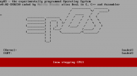

# EpOS

| epOS |  |
| ----------------------------------------------------------------------------------------------------- | ------------------------------------------------------------------------------------------------------------------------ |
|  |  |
| Entwickler: | [DesL](https://lowlevel-eu.github.io/wiki/pages/1770/index.html "Benutzer:Dem epOS sein Linus") |
| Akt. Version: | 0.08 in Entwicklung |
| [Lizenz](Lizenzen.md "Lizenzen"): | Im Moment Closed-Source |
| OS-Eigenschaften |  |
| Plattform: | [x86](X86.md "X86") |
| [Kernelart](Kernel.md "Kernel"): | [Monolithischer Kernel](Kernel.md#monolithischer-kernel "Monolithischer Kernel") |
| [Sprache](Kategorie-Programmiersprache.md "Kategorie:Programmiersprache"): | C/C++ |
| API: |  |
| Binärformat: |  |
| [IPC-Methode](Interprozesskommunikation.md "IPC"): |  |
| Homepage |  |

<http://desl.bplaced.net>

  
Hi, ich bin [dem epOS sein Linus (DesL)](https://lowlevel-eu.github.io/wiki/pages/1770/index.html "Benutzer:Dem epOS sein Linus")  
und dass hier ist eben epOS.  
Wofür steht epOS? Ganz einfach: **e**xperimentally **p**rogrammed **O**perating **S**ystem!  

## Features

- Basics wie GDT, IDT und PIC
- Textausgabe
- PMM
- Multitasking
- Keyboard
- Paging
- Heap
- VFS/initrd
- laden eines Programms von der initrd + ausführen

## in Arbeit

- Netzwerk:
  - RTL8139
  - Ethernet
  - diverse Protokolle
- PCI
- Shell
- Treiberschicht, Auslagerung einiger Komponenten in Binaries

## Geplant

- Multitasking/Usermode
- Floppy/Festplatten Zugriff
- CDI?
- entsprechende Befehle in der Komzei
- GUI
- und überhaupt alles...

## Realease

Steht noch in den Sternen, je nach Zeit, Lust und Laune. Und vor allem nach Stabilität. Im Moment ist v0.07 fertig, steht mittlerweile auch zum Download, aber die Featurelist ist immer noch maximal durchschnittlich.

## History/Archiv

- v0.01 - 29.11.09
  - Simple Textausgabe in C++, färben von Text und BG
- v0.02 - 04.03.10
  - GDT
  - IDT
  - PIC
- v0.03 - 10.04.10
  - CMOS (-\>Systemzeit)
  - überarbeitung von GDT
- v0.04 - 30.05.10
  - PMM
  - Multitasking (Kernel)
- v0.05 - 07.06.10
  - rudimentärer Tastatur-"treiber"
  - Paging
  - Heap
- v0.06 - 13.10.10
  - VFS/initrd
  - KB-Treiber überarbeitet
  - Bugfix in der Heapverwaltung
- v0.07 - 06.03.11
  - Paging neu implementiert (war mir zu nahe am Tutorial)
  - PMM neu implementiert: vormals BMP, jetzt Freispeicherliste, inklusive Bugfix.
  - Heap: Bugfix, Pages werden nun durch vmm (1:1) gemappt
  - "Prozess" von der initrd laden und ausführen

## Screenshot

 epOS V0.1

Greetz [DesL](https://lowlevel-eu.github.io/wiki/pages/1770/index.html "Benutzer:Dem epOS sein Linus")

---

[Originalversion und Autorenschaft](https://lowlevel-eu.github.io/wiki/revisions/9821/index.html) · [MediaWiki-Versionsgeschichte](https://lowlevel-eu.github.io/wiki/history/1771/index.html)

<!-- MediaWiki page 1771; revision 9821; parent 9820; 2011-06-02T23:30:06Z -->
