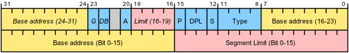

# Global Descriptor Table

Die Global Descriptor Table (auch GDT) ist eine i386+-spezifische Struktur, welche Informationen über Speicherabschnitte (Segmente) enthält.

## Segmentierung

### 16-Bit Real Mode

Der 8086 ist ein 16-Bit-Prozessor. Das bedeutet, dass seine Register 16 Bit breit sind und somit Werte bis 2<sup>16</sup> - 1 = 65535 aufnehmen können. Nun müssen aber auch Zeiger in dieser Register passen, und auf diese Weise können nur 64 KiB adressiert werden, was bereits bei der Einführung des Prozessors nicht gerade einen großzügiger Adressraum darstellte.

Aus diesem Grund wurde im Real Mode eine einfache Art von Segmentierung eingeführt. Zu jedem Speicherzugriff wird noch eine Basisadresse addiert, die durch den Inhalt des entsprechenden Segmentregisters (*cs* für Code, *ds* für Daten, *ss* für den Stack) bestimmt ist. Dadurch sind Adressen effektiv 20 Bit groß; es sind also 1 MiB Adressraum zugänglich, wobei beim Zugriff auf mehr als 64 KiB das Segmentregister gewechselt werden muss.

Die Berechnung einer effektiven Adresse – im Beispiel ein Zugriff auf *\[ds:ax\]* – läuft wie folgt ab:

    0x  1234   Adresse in ax
    0x 4321    Segmentregister ds 
    ========
    0x 44444   Tatsächlich zugegriffene Adresse

### 16-Bit Protected Mode

Mit der Zeit erwies sich auch der 1 MiB große Speicher nicht mehr als ausreichend, nicht zuletzt, da von diesem knapp die Hälfte für das BIOS und andere Sonderaufgaben reserviert war. Außerdem ermöglichte die Real-Mode-Segmentierung keinen Speicherschutz, da jedes Programm trotzdem auf alle Adressen zugreifen konnte, was die Unterscheidung verschiedener Privilegstufen unmöglich machte. Auch eine Speicherverwaltung wurde schwierig, wenn man nicht jedes mal alle zu ladenden Segmentadressen korrigieren wollte. Aus diesem Grund wurde mit dem Protected Mode ein neues, komplexeres Segmentierungskonzept eingeführt.

Da die 80286 über 24 Adressleitungen verfügte und damit auf 16 MiB Speicher zugreifen konnte, und auch noch Speicherschutzinformationen gespeichert werden sollten, erwiesen sich die 16 Bit des Segmentregisters als zu knapp, um alle diese Informationen aufzunehmen. Außerdem sollten die Daten von den Anwendungsprogrammen nicht beliebig, aber doch im vorgegebenen Rahmen änderbar sein. Aus diesem Grund enthalten die Segmentregister im Protected Mode nur noch sogenannte Selektoren, d. h. die Nummer eines Segments und einige wenige Flags. Die eigentliche Beschreibung der Segmente liegt in Form einer Tabelle im Speicher, der *Global Descriptor Table* (GDT). Die GDT besteht aus mehreren Einträgen (Segmentdeskriptoren) zu je 64 Bit, die direkt hintereinander liegen. Diese Einträge konnten problemlos eine 24 Bit breite Basisadresse sowie ein Limit, das die Größe des Segements beschreibt, sowie die Privilegstufe und weiter Daten aufnehmen. Auch für besondere Einträge war noch Platz.

Für individuelle Programme gibt es auch noch eine weitere ähnlich aufgebaute Tabelle, die *Local Descriptor Table* (LDT). Ein Programm konnte so auf eine vom System vorgegebene Anzahl an Segmenten zugreifen, die in beiden Tabellen beschrieben sind und jeweils vom System nach den verfügbaren Ressourcen und den Bedürfnissen des Programmes vorgegeben wurden.

### 32-Bit Protected Mode

Auch im 32-Bit [Protected Mode](Protected-Mode.md "Protected Mode") des 386 sind Segmente noch vorhanden, sie spielen aber eine etwas andere Rolle. Ihre alte Aufgabe haben sie zumindest teilweise verloren, denn der 386 ist ein 32-Bit-Prozessor und könnte die verfügbaren 4 GiB Speicher ohne Segmentierung ansprechen.

Zum einen kann die Basisadresse aber auch weiterhin nützlich sein – sie erlaubt es, Code an beliebigen Stellen im Speicher auszuführen, auch wenn er von festen Adressen ausgeht (dieser Mechanismus wird aber nur selten benutzt). Zum anderen sind die Segmente erweitert worden, so dass sie nicht nur einfach aus einer Basisadresse bestehen, sondern zusätzliche Speicherschutzfunktionalität bieten, wie Schreibschutz oder Zugriff erst ab einem bestimmten Privileglevel. Außerdem hat ein Segment nicht mehr eine starre Länge von 64 KiB, sondern die Länge kann vom Betriebssystem für jedes Segment einzeln und flexibel festgelegt werden. Protected-Mode-Segmente können also nahezu beliebig im linearen/virtuellen Adressraum positioniert werden.

Trotz allem ist zu sagen, dass die meisten Betriebssystem die Speicherverwaltung im 32-Bit-Modus hauptsächlich über das flexiblere Paging durchführen und die Möglichkeiten der GDT nicht ausschöpfen. Diese Betriebssysteme verwenden das "flat memory"-Modell, in dem die Segmentierung faktisch umgangen wird: Der gesamte Speicher wird durch ein einziges, großes Segment wiedergegeben.

### Long Mode

Nichtsdestotrotz spielt auch im "flat memory"-Modell die GDT für die Privilegienverwaltung weiterhin eine Rolle, auch wenn sie die Funktion als Speicherverwalter im Long Mode endgültig verloren hat, da dieser das "flat memory"-Model erzwingt. Außerdem hat sie nicht zuletzt die entscheidende Aufgabe, den Wechsel zwischen dem *Legacy Mode* für 32-Bit-Programme und dem 64-Bit-Modus zu koordinieren. Eine eingehende Beschäftigung mit der GDT ist daher allemal sinnvoll.

## Selektoren

Wie im vorigen Abschnitt erwähnt, stehen im Protected Mode in den Segmentregistern Selektoren, die auf Deskriptortabellen verweisen. Sie haben den folgenden Aufbau:

| Bits | Wert | Bedeutung |
| -------- | -------- | --------------------------------------------------------------------------------------------------------------------------------------------------------------------------------------------------------------------------------------- |
| 0 - 1 | 0x3 | RPL (Requested Privilege Level). Gibt die Privilegstufe (den Ring) an mit der versucht werden soll das Segment anzusprechen, falls diese numerisch kleiner ist als die aktuelle des aufrufenden Tasks so behält dieser seine aktuelle |
| 2 | 0x4 | Bestimmt, ob ein Eintrag in der GDT (Bit nicht gesetzt) oder in der LDT (Bit gesetzt) ausgewählt wird |
| 3 - 15 | 0xfff8 | Nummer des Eintrags in der GDT bzw. LDT (ab Null gezählt) |

Um also nach *ds* das Segment zu laden, das durch den fünften GDT-Eintrag beschrieben wird, und zwar als Userspace-Segment (Ring 3), könnte man folgenden Code verwenden:

``` asm
mov $0x23, %ax
mov %ax, %ds
```

## Struktur

Jeder Eintrag in den GDT besteht aus acht Bytes.

Beim Erstellen der GDT sollte man beachten, dass der erste Eintrag der sogenannte Nulldeskriptor ist. Er ist grundsätzlich ungültig und der Eintrag kann komplett auf 0 gelassen werden. Erst ab dem zweiten Eintrag fangen die tatsächlich benutzten Deskriptoren an.

### Struktur eines Eintrages

| Byte | Name | Bits |
| ------ | ------------ | ------------------- |
| 0 | Limit | 0-7 |
| 1 | Limit | 8-15 |
| 2 | Base | 0-7 |
| 3 | Base | 8-15 |
| 4 | Base | 16-23 |
| 5 | Accessbyte | 0-7 (vollständig) |
| 6 | Limit | 16-19 |
| 6 | Flags | 0-3 (vollständig) |
| 7 | Base | 24-31 |

[](assets/SegmentDescriptor.png)

### Bedeutung

| Name | Bedeutung |
| ------------ | ---------------------------------------------------------------------------------- |
| Limit | Größe des Segments - 1 (entweder in Bytes oder in 4 KiB-Einheiten – siehe Flags) |
| Base | Die Addresse wo das Segment beginnt |
| Accessbyte | Zugriffsinformationen (Ring, executable, etc.) |
| Flags | Definiert die Segmentgrößeneinheit und 16/32 Bit. |

### Das Access-Byte

| Bit | Wert | Name | Bedeutung |
| -------- | ------ | ------------------------------ | -------------------------------------------------------------------------------------------------------------------------------------------------------------------------------------------------------------------------------------------------------------------- |
| 7 | 0x80 | Present Bit | Muss 1 für einen aktiven Eintrag sein |
| 6 u. 5 | 0x60 | Privilege | Ring - von Ring 0 (Kernel Mode) zu Ring 3 (User Mode) |
| 4 | 0x10 | Segment Bit | Ist 1 für Code-/Datensegmente; 0 für Gates und [TSS](Task-State-Segment.md "TSS"). Bits 0 bis 3 in dieser Tabelle gelten nur für Code-/Datensegmente, ansonsten enthalten sie den genauen Segmenttyp (z. B. 0x9 für 386-TSS) |
| 3 | 0x08 | Executable Bit | Bei 1 ist das Speichersegment ein Codesegment, bei 0 ein Datensegment |
| 2 | 0x04 | Direction Bit/Conforming Bit | Bedeutung abhängig vom Executable-Bit |
| 1 | 0x02 | Readable Bit/Writable Bit | Bei einem Codesegment ob lesen erlaubt ist, bei einem Datensegment ob schreiben erlaubt ist |
| 0 | 0x01 | Accessed Bit | Sollte 0 gesetzt werden, wird dann vom Prozessor bei Zugriff gesetzt. |

### Die Flags

| Bit | Wert | Name | Bedeutung |
| ----- | ------ | ----------------- | ------------------------------------------------------------------------------------------------------------------------------------------------------------------------------------------------------------------------------------------------------------------------------------------------------------------------------- |
| 3 | 0x8 | Granularity Bit | Bei 0 wird als Einheit bei Limit ein Byte benutzt, bei 1 stattdessen 4 KiB |
| 2 | 0x4 | Size Bit | 0 bedeutet 16 Bit Protected Mode, bei 1 32 Bit Protected Mode. |
| 1 | 0x2 | Long Mode Bit | 0 bedeuted Protected Mode, 1 bedeutet Long Mode. Bei gesetztem Long Mode Bit **muss** das Size Bit 0 sein! Ist das Long Mode Bit 0, so gibt das Size Bit die Bit-Größe des Protected Mode Segments an. *Dieses Bit sollte nur bei einem Code Segment gesetzt werden, bei anderen Segment-Typen sollte es auf 0 gesetzt sein.* |
| 0 | 0x1 | Available Bit | Dieses Bit steht dem Programmierer zur freien Verfügung. |

## Einrichten der GDT

Bevor wir überlegen, welche Segmente wir in unserer GDT definieren wollen, brauchen wir zunächst eine Funktion, um GDT-Einträge in halbwegs lesbarer Form anzulegen. Angenommen die GDT wird als Array von 64-Bit-Integern dargestellt, könnte das wie folgt aussehen. Der Code macht nichts anderes, als die Parameter an die richtige Position gemäß den oben angegebenen Tabellen zu schieben:

``` c
static void set_entry(int i, unsigned int base, unsigned int limit, int flags)
{
    gdt[i] = limit & 0xffffLL;
    gdt[i] |= (base & 0xffffffLL) << 16;
    gdt[i] |= (flags & 0xffLL) << 40;
    gdt[i] |= ((limit >> 16) & 0xfLL) << 48;
    gdt[i] |= ((flags >> 8 )& 0xffLL) << 52;
    gdt[i] |= ((base >> 24) & 0xffLL) << 56;
}
```

Welche Segmente Du anlegen willst, hängt natürlich von der Architektur Deines Kernels ab. Mein Vorschlag ist nicht die absolute und einzige Wahrheit, aber er ist ein guter Anfang, wenn Du Dir unsicher bist. Grundlage ist die GDT, wie [týndur](T%C3%BDndur.md "Týndur") sie verwendet und wie sie in den meisten anderen Betriebssystemen anzutreffen ist. Speicherschutz wird dabei über [Paging](Paging.md "Paging") erledigt, so dass nur ein Minimalsatz von Segmenten übrigbleibt:

- Ein Nulldeskriptor (gdt\[0\] = 0)
- Ein Codesegment für den Kernel (Present, Ring 0, Executable, 32 Bit; Basis 0, Limit 4 GiB)
- Ein Datensegment für den Kernel (Present, Ring 0, Non-Executable, 32 Bit; Basis 0, Limit 4 GiB)
- Ein Codesegment für den Userspace (Present, Ring 3, Executable, 32 Bit; Basis 0, Limit 4 GiB)
- Ein Datensegment für den Userspace (Present, Ring 3, Non-Executable, 32 Bit; Basis 0, Limit 4 GiB)
- Ein [Task State Segment](Task-State-Segment.md "Task State Segment") für Multitasking (Present, Ring 3, 386-TSS)
- Ein [Task State Segment](Task-State-Segment.md "Task State Segment") zur Behandlung von Double Faults (Present, Ring 3, 386-TSS)

Absolut nötig sind dabei nur Nulldeskriptor und Code-/Datensegment für den Kernel. Sobald Multitasking ins Spiel kommen soll, ist das TSS fällig und mit Userspace-Prozessen braucht es dann die Code-/Datensegmente für Ring 3.

Das zweite TSS für Double Faults ist komplett optional. Double Faults entstehen oft dadurch, dass z. B. die Pagingstrukturen überschrieben worden sind und der Handler für einen Page Fault selbst nicht mehr funktioniert. Ein TSS bietet hier die Möglichkeit, in einen sauberen Prozessorzustand zu springen und wenigstens noch eine sinnvolle Fehlermeldung auszugeben.

## Laden der GDT

Nachdem der Kernel eine GDT im Speicher liegen hat, die er für seine Segmente verwenden möchte, muss er das Register GDTR ändern. Dieses Register enthält die Adresse und das sogenannte Limit der GDT &#150; dies entspricht ihrer Länge minus ein Byte &#150; und wird über den Befehl **lgdt** geladen. Da das Register 6 Bytes breit ist, kann dieser Befehl den neuen Wert nicht direkt als Operand entgegennehmen, sondern erwartet einen Pointer auf eine Speicherstelle, die diese 6 Bytes enthält:

``` c
static uint64_t gdt[GDT_ENTRIES];

// ...

struct {
    uint16_t limit;
    void* pointer;
} __attribute__((packed)) gdtp = {
    .limit = GDT_ENTRIES * 8 - 1,
    .pointer = gdt,
};
asm volatile("lgdt %0" : : "m" (gdtp));
```

Dadurch wird allerdings nur der Verweis auf die Tabelle geändert, tatsächliche Auswirkungen hat die Änderung noch nicht. Auf die Tabelle wird nur zugegriffen, wenn ein Segmentregister neu geladen wird. Daher müssen jetzt noch alle Segmentregister neu geladen werden:

``` asm
mov $0x10, %ax
mov %ax, %ds
mov %ax, %es
mov %ax, %fs
mov %ax, %gs
mov %ax, %ss
ljmp $0x8, $.1
.1:
```

## Web-Links

[Protected-Mode-Tutorial der FH Zwickau](http://www.fh-zwickau.de/doc/prmo/pmtutor/text/)

---

[Originalversion und Autorenschaft](https://lowlevel-eu.github.io/wiki/revisions/11395/index.html) · [MediaWiki-Versionsgeschichte](https://lowlevel-eu.github.io/wiki/history/1661/index.html)

<!-- MediaWiki page 1661; revision 11395; parent 11383; 2018-09-04T10:21:49Z -->
