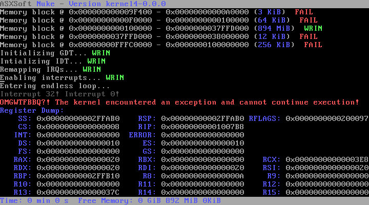

# Nuke

| [GPLv3](Lizenzen.md "GPL") |  |
| ----------------------------------------------------------------------------------------------------- | --------------------------------------------------------------------------------------------------------------------------------- |
|  |  |
| Entwickler: | [SHyx0rmZ](https://lowlevel-eu.github.io/wiki/pages/1785/index.html "Benutzer:SHyx0rmZ") |
| Akt. Version: | kernel5-0.0.1 |
| [Lizenz](Lizenzen.md "Lizenzen"): | [AVOL](http://avol.asxsoft.de) |
| OS-Eigenschaften |  |
| Plattform: | [x64](X86-64.md "X64") |
| [Kernelart](Kernel.md "Kernel"): | Exokernel |
| [Sprache](Kategorie-Programmiersprache.md "Kategorie:Programmiersprache"): | [Assembler](Assembler.md "Assembler"),[C](C.md "C") |
| API: | *noch nicht vorhanden* |
| Binärformat: | [ELF](Executable-and-Linking-Format.md "ELF") |
| [IPC-Methode](Interprozesskommunikation.md "IPC"): | *noch nicht vorhanden* |
| Homepage |  |

[gitorious.org/nuke/kernel5](http://www.gitorious.org/nuke/kernel5)

  
Nuke ist mein Hobby OS, welches ursprünglich mal nur im Long Mode laufen sollte. Jetzt gibt es Nuke aber auch für Leute ohne Long Mode CPU. Hauptziel von Nuke was es, dem Benutzer eine schnelle Arbeit am Computer zu gewährleisten. Nuke soll es nun einigermaßen schaffen, einen Exokernel umzusetzen. Inwieweit mir dies gelingt weiß ich allerdings selbst noch nicht abzuschätzen ^^

## Screenshot

 Dieser Screenshot zeigt noch kernel4, welcher nicht mehr in der Entwicklung befindlich ist

## Aktuelle Features

- SMP (zumindest fast fertig ^^)
- PMM
- Syscalls

## Die Zukunft

Genauere Pläne stehen noch nicht fest. Sicher ist aber, dass Nuke eine libPosix bekommen wird und auch einmal Linuxprogramme unterstützen soll. Zudem ist angedacht, [CDI](Common-Driver-Interface.md "CDI") zu implementieren.

## Ehemals Geplante Features

- *NukeFS*
- *Initial Ramdisk*
- *AVOP* (Interpreter-Sprache)
- *HAL-Lib*
- *angepasstes Tastatur-Layout*
- *Festplatte beschreiben/lesen* (RAW)
- *AMD Processor Optimization Module*

## Historie

kernel4-0.0.1

- Paging
- Rudimentäres MM
- delete/delete\[\] und new/new\[\] (Funktioniert, solang Objekt kleinergleich Pagegröße)
- IRQ0-Handler alloziert zu Demonstrationszwecken Speicher

kernel4-0.0.0

- Neuester Rewrite, dazwischen liegen noch ein paar Versionen, kernel3 gab's sogar auch mal (glaub ich zumindest)
- Alles so weit wie möglich in C++0x
- Zielsetzung: Nuke endlich mal benutzbar bekommen und Neueinsteigern Resourcen bieten (Kommentare, UML-Diagramme, ...)

Ver **00004**

- Rudimentäre Speicherverwaltung
- Rudimentäres Paging
- Multitasking

Ver **00003**

- IDT & GDT für Long Mode
- Exceptions & IRQs werden durch einen Stub-Handler abgefangen
- Long Mode
- Arbeitsspeicher wird erkannt

  
Ver **00002**

- GDT wird geladen
- Protected Mode

  
Ver **00001**

- Werte der Register auslesbar
- VGA
- Kernel wird von Floppy gelesen

  
Ver **00000**

- Bootloader gibt *Hallo Welt* aus und rebootet nach Tastendruck

---

[Originalversion und Autorenschaft](https://lowlevel-eu.github.io/wiki/revisions/9232/index.html) · [MediaWiki-Versionsgeschichte](https://lowlevel-eu.github.io/wiki/history/1750/index.html)

<!-- MediaWiki page 1750; revision 9232; parent 8908; 2011-01-03T01:02:19Z -->
