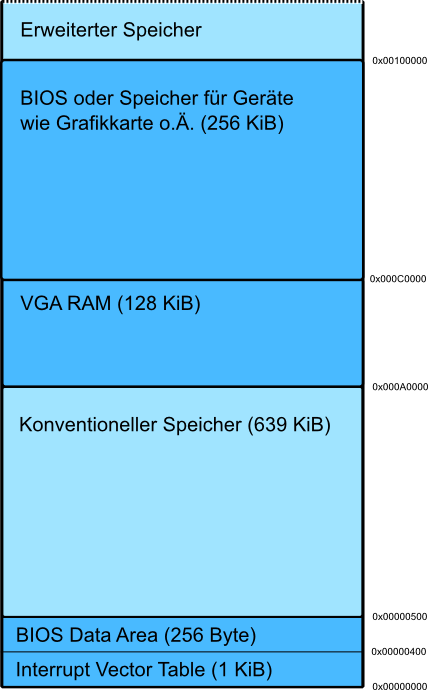

# Speicherbereiche

Eine Übersicht über die Speicherbereiche unter der 1MB-Grenze gibt folgende Grafik:

  

  

## Siehe auch

- [Interrupt Vector Table](Interrupt-Vector-Table.md "Interrupt Vector Table")
- [BIOS Data Area](BIOS-Data-Area.md "BIOS Data Area")
- [Extended BIOS Data Area](Extended-BIOS-Data-Area.md "Extended BIOS Data Area")
- [VGA RAM](Video-Graphics-Array.md "VGA")
- [BIOS](Basic-Input-Output-System.md "BIOS")

---

[Originalversion und Autorenschaft](https://lowlevel-eu.github.io/wiki/revisions/11003/index.html) · [MediaWiki-Versionsgeschichte](https://lowlevel-eu.github.io/wiki/history/1563/index.html)

<!-- MediaWiki page 1563; revision 11003; parent 9001; 2013-02-20T00:58:01Z -->
